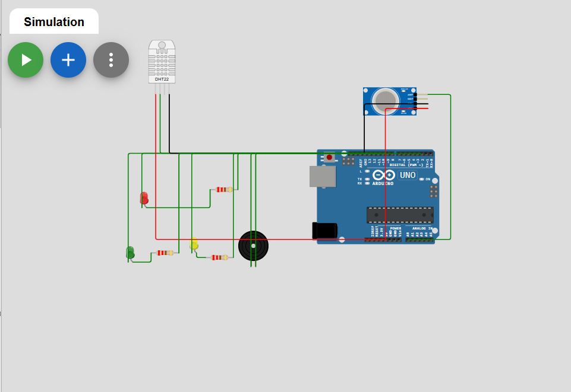
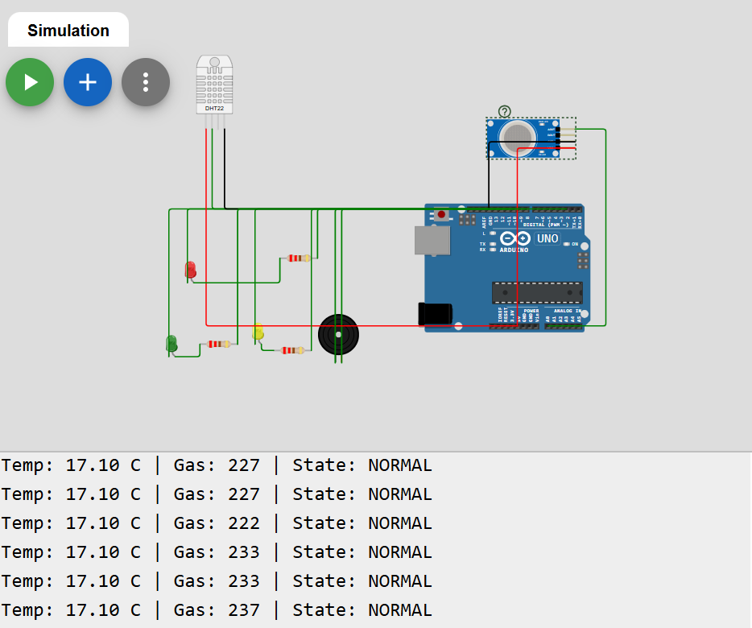
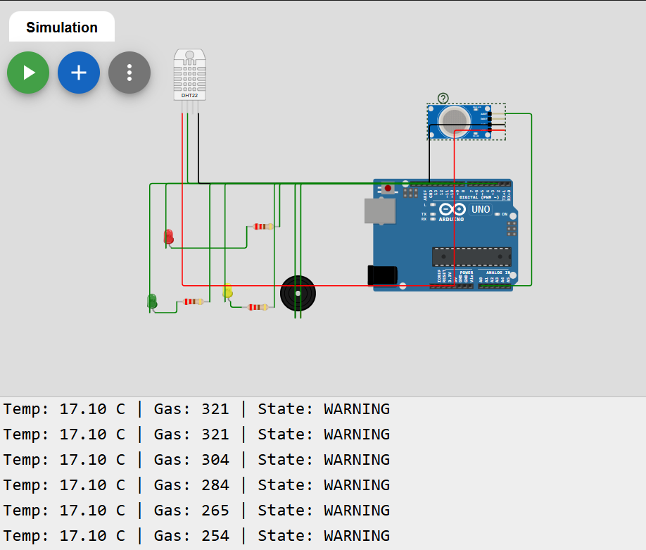

# Fire & Gas Safety Monitor

A simulated safety monitor built on Arduino Uno (Wokwi). It reads temperature (DHT22) and gas level (MQ-2) and shows one of three states with LEDs and a buzzer.

## States
| State | Condition | Output |
|---|---|---|
| Normal | gas < 250 and temp < 40 C | Green LED |
| Warning | gas >= 250 or temp >= 40 C | Yellow LED + short beeps |
| Alarm | gas >= 350 or temp >= 55 C | Red LED + continuous buzzer |

## Features
- 3-state machine with hysteresis (no flickering)
- Non-blocking timing using millis()
- ADC noise reduction by averaging 8 readings
- Sensor fault handling (a failed temperature read does not stop gas monitoring)

## Components (simulated)
Arduino Uno, DHT22, MQ-2 gas sensor, 3 LEDs, 3 x 220 ohm resistors, buzzer

## Pin connections
| Part | Pin |
|---|---|
| DHT22 data | 2 |
| Gas sensor AOUT | A0 |
| Green LED | 8 |
| Yellow LED | 9 |
| Red LED | 10 |
| Buzzer | 11 |

## How to run
1. Open Wokwi and create an Arduino Uno project.
2. Paste sketch.ino and diagram.json.
3. Add the DHT sensor library (see libraries.txt).
4. Press Run and move the sensor sliders.

## Screenshots

## What I learned
Embedded C, ADC reading, state machines, debugging wiring faults.

## Author
Potta Geetha Naga Kowmudhi
